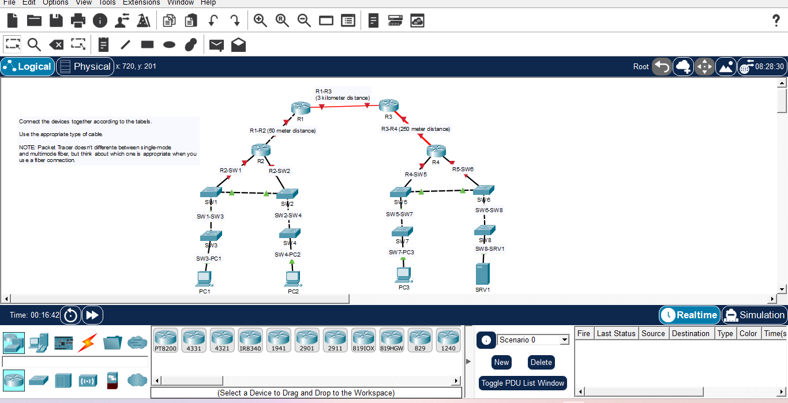

# Day 02: Connecting Devices - Cables and Distances

## Course Reference
-**Course**: Jermy's IT Lab - CCNA

-**Topic**: Network Cabling, Devices Connection & Distances

## Objective
Connect network devices according to the given table, using the appropriate cable type for each connection, and considering the distance between devices.

## Network Topology

## Devices Used

| Device | Model | Quantity |
|--------|-------|----------|
| **Router** | Cisco Router | 4 (R1, R2, R3, R4) |
| **Switch** | Cisco Switch | 8 (SW1 - SW8) |
| **PC** | Generic PC | 3 (P1, PC2, PC3) |
| **Server** | Generic Server | 1 (SRV1) |

## Steps

1. Placed all devices in the workspace.
2. Connected **R1 to R2** usig a **Copper Straight-Through** cable (50m).
3. Connected **R1 to R3** usig a **Fiber Optic (Single-Mode)** cable (3km).
4. Connected **R3 to R4** usig a **Fiber Optic (Multi-Mode)** cable (250km)..
5. Connected routers to their respective switches (R2 to SW1, R2 to SW2, R4 to SW5, R4 to SW6).
6. Connected switches to end devices (PCs and Server).
7. Verified that all connection use the appropriate cable type.

## What I Learned
1. **Cable Types**:
    - **Copper Straight-Through**: Used for connecting **different** device typrs (Router to Switch, Switch to PC).
    - **Copper Crossover**: Used for connecting **same** devuce types (Switch to Switch, Router to Router).
    - **Fiber Optic**: Used for **long distances** (over 100 meters).
2. **Distance Rules**:
    - **Copper Ethernet**: Up to **100 meters**
    - **Fiber Optic (Multi-Mode)**: Up to **500 meters**
    - **Fiber Optic (Single-Mode)**: Up to **several kilometers**
3. **Choosing the Right Cable**:
    - **Short distance (< 100m)**: Copper Straight-Through.
    - **Medium distance (100m - 550m)**: Fiber Optic (Multi-mode).
    - **Long distance (> 550m)**: Fiber Optic (Single-mode).
4. **Packet Tracer Note**:
    - Packet tracer doesn't differentiate between Single-Mode and Multi-Mode fiber, but in real life, we must choose the one.

----