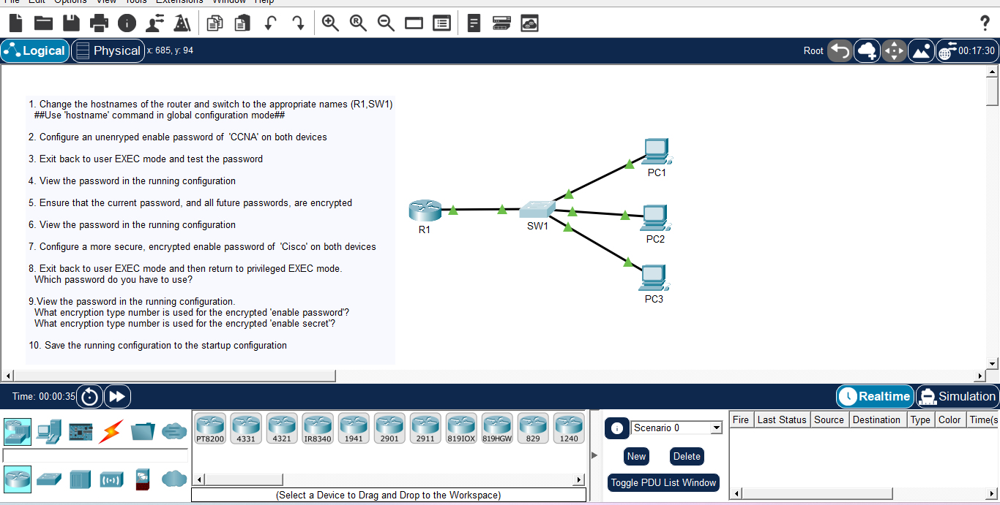

# Day 04: Device Configuration - Passwords & Encryption

##  Course Reference
- Course: Jeremy's IT Lab - CCNA 200-301
- Topic: Basic Device Configuration, Passwords, and Encryption

## Objective
Configure hostnames, enable passwords, and encrypt passwords on Cisco devices (Router R1 and Switch SW1).

##  Network Topology

##  Devices Used
| Device | Type | Hostname |
|--------|------|----------|
| Router | Cisco Router | R1 |
| Switch | Cisco Switch | SW1 |
| PCs | Generic PC | PC1, PC2, PC3 |

##  Configuration Steps

### Step 1: Change Hostnames
On R1:
enable
configure terminal
hostname R1
exit

On SW1:
enable
configure terminal
hostname SW1
exit

### Step 2: Configure Unencrypted Enable Password
On both devices:
enable
configure terminal
enable password CCNA
exit

### Step 3: Test Password
exit
enable
Password: CCNA

### Step 4: View Password
show running-config

### Step 5: Encrypt Future Passwords
configure terminal
service password-encryption
exit

### Step 6: View Encrypted Password
show running-config

### Step 7: Configure Stronger Password
configure terminal
enable secret Cisco
exit

### Step 8: Test Password
exit
enable
Password: Cisco (enable secret takes precedence)

### Step 9: View Both Passwords
show running-config

### Step 10: Save Configuration
copy running-config startup-config

##  What I Learned
1. Hostname: Changes device name for identification.
2. Enable Password: Stored in plain text by default, can be encrypted .
3. Enable Secret: Automatically encrypted with MD5 , takes precedence.
4. Service Password-Encryption: Encrypts all future passwords .
5. Saving Config: copy running-config startup-config saves to NVRAM.

---