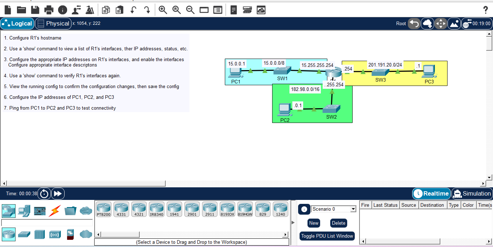

# Day 03: Interface Configuration & IP Addressing

## Course Reference
- Course: Jeremy's IT Lab - CCNA 200-301
- Topic: Router Interface Configuration, IP Addressing, and Connectivity Testing

## Objective
Configure R1's interfaces with appropriate IP addresses, enable them, and test connectivity between PCs in different subnets.

## Network Topology

## Devices Used
| Device | Type | IP Address | Subnet |
|--------|------|------------|--------|
| PC1 | Generic PC | 15.0.0.1/8 | 15.0.0.0/8 |
| PC2 | Generic PC | 182.98.0.1/16 | 182.98.0.0/16 |
| PC3 | Generic PC | 201.191.20.1/24 | 201.191.20.0/24 |
| R1 | Cisco Router | (3 interfaces) | - |
| SW1 | Cisco Switch | - | - |
| SW2 | Cisco Switch | - | - |
| SW3 | Cisco Switch | - | - |

## 📋 Configuration Steps

### Step 1: Configure R1's Hostname
enable
configure terminal
hostname R1
exit

### Step 2: View R1's Interfaces
show ip interface brief

### Step 3: Configure IP Addresses on R1's Interfaces

interface GigabitEthernet0/0
 ip address 15.255.255.254 255.0.0.0
 description to SW1
 no shutdown
 exit

interface GigabitEthernet0/1
 ip address 182.98.255.254 255.255.0.0
 description to SW2
 no shutdown
 exit

interface GigabitEthernet0/2
 ip address 201.191.20.254 255.255.255.0
 description  to SW3
 no shutdown
 exit

### Step 4: Verify Interfaces
show ip interface brief

### Step 5: View and Save Configuration
show running-config
copy running-config startup-config

### Step 6: Configure IP Addresses on PCs
PC1: IP 15.0.0.1, Subnet Mask 255.0.0.0, Gateway 15.255.255.254
PC2: IP 182.98.0.1, Subnet Mask 255.255.0.0, Gateway 182.98.255.254
PC3: IP 201.191.20.1, Subnet Mask 255.255.255.0, Gateway 201.191.20.254

### Step 7: Test Connectivity
From PC1:
ping 182.98.0.1
ping 201.191.20.1

## What I Learned
1. Interface Configuration: Assigning IP addresses and enabling interfaces.
2. Subnetting: Using /8, /16, /24 masks appropriately.
3. Gateway: Each PC needs the router's interface IP as its default gateway.
4. Show Commands: show ip interface brief shows interface status.
5. Saving Config: copy running-config startup-config persists changes.
6. Connectivity Testing: Ping verifies end-to-end connectivity.

---