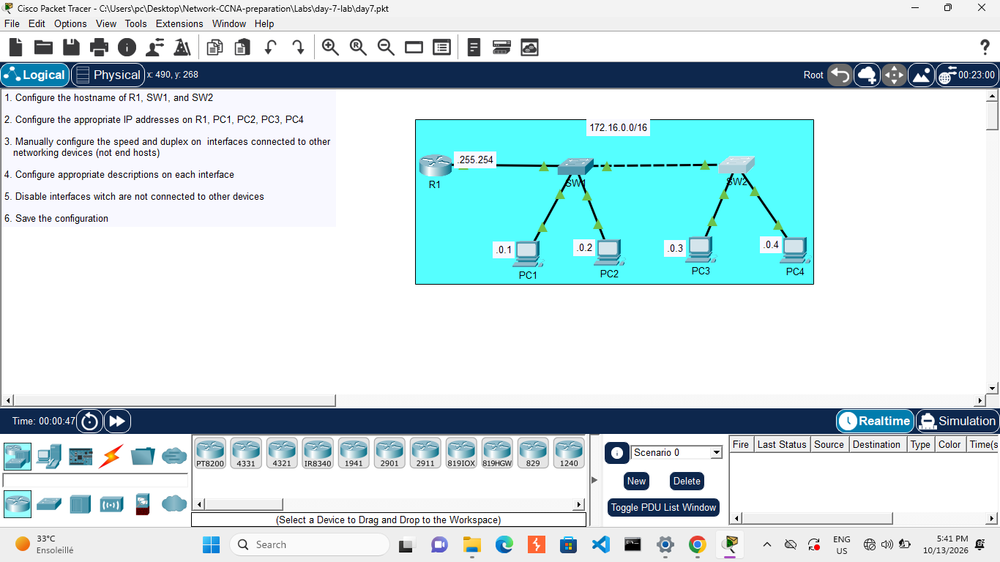

# Day 07: Interface Configuration - Speed, Duplex & Descriptions

## Course Reference
- Course: Jeremy's IT Lab - CCNA 200-301
- Topic: Interface Configuration, Speed, Duplex, and Descriptions

## Objective
Configure hostnames, IP addresses, interface speed/duplex, descriptions, and disable unused interfaces on R1, SW1, and SW2.

## Network Topology

## Devices Used
| Device | Type | IP Address | Subnet |
|--------|------|------------|--------|
| PC1 | Generic PC | 172.16.0.1/16 | 172.16.0.0/16 |
| PC2 | Generic PC | 172.16.0.2/16 | 172.16.0.0/16 |
| PC3 | Generic PC | 172.16.0.3/16 | 172.16.0.0/16 |
| PC4 | Generic PC | 172.16.0.4/16 | 172.16.0.0/16 |
| R1 | Cisco Router | 172.16.255.254/16 | - |
| SW1 | Cisco Switch | - | - |
| SW2 | Cisco Switch | - | - |

## Configuration Steps

### Step 1: Configure Hostnames
On R1:
enable
configure terminal
hostname R1
exit

On SW1:
enable
configure terminal
hostname SW1
exit

On SW2:
enable
configure terminal
hostname SW2
exit

### Step 2: Configure IP Addresses
On R1:
interface GigabitEthernet0/0
 ip address 172.16.255.254 255.255.0.0
 no shutdown
 exit

On PCs:
PC1: IP 172.16.0.1, Subnet Mask 255.255.0.0, Gateway 172.16.255.254
PC2: IP 172.16.0.2, Subnet Mask 255.255.0.0, Gateway 172.16.255.254
PC3: IP 172.16.0.3, Subnet Mask 255.255.0.0, Gateway 172.16.255.254
PC4: IP 172.16.0.4, Subnet Mask 255.255.0.0, Gateway 172.16.255.254

### Step 3: Configure Speed and Duplex
On R1:
interface GigabitEthernet0/0
 speed 1000
 duplex full
 exit

On SW1 (interfaces connected to other devices):
interface GigabitEthernet0/1
 speed 1000
 duplex full
 exit

interface GigabitEthernet0/2
 speed 1000
 duplex full
 exit

On SW2 (interfaces connected to other devices):
interface GigabitEthernet0/1
 speed 1000
 duplex full
 exit

interface GigabitEthernet0/2
 speed 1000
 duplex full
 exit

### Step 4: Configure Descriptions
On R1:
interface GigabitEthernet0/0
 description Connection to SW1
 exit

On SW1:
interface GigabitEthernet0/1
 description Connection to R1
 exit

interface GigabitEthernet0/2
 description Connection to SW2
 exit

On SW2:
interface GigabitEthernet0/1
 description Connection to SW1
 exit

### Step 5: Disable Unused Interfaces
On R1:
interface GigabitEthernet0/1
 shutdown
 exit

interface GigabitEthernet0/2
 shutdown
 exit

### Step 6: Save Configuration
On all devices:
copy running-config startup-config

## What I Learned
1. Hostname: Identifies the device on the network.
2. IP Addressing: Assigns logical addresses to interfaces.
3. Speed & Duplex: Manually setting speed (1000 Mbps) and duplex (full) avoids mismatches.
4. Descriptions: Help identify what each interface is connected to.
5. Shutdown: Disabling unused interfaces improves security and reduces noise.
6. Saving Config: copy running-config startup-config persists changes to NVRAM.

---