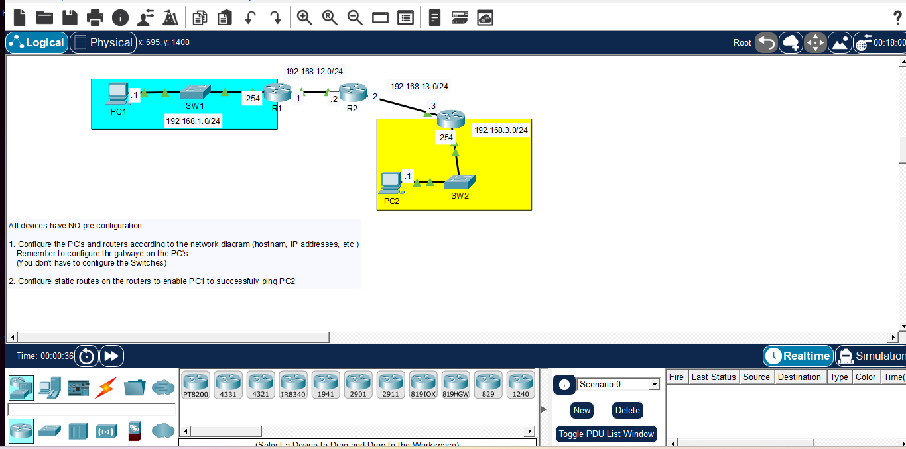

# Day 08: Static Routing Configuration

## Course Reference
- Course: Jeremy's IT Lab - CCNA 200-301
- Topic: Static Rouring, IP Addressing, and Gateway Configuration

## Objective
Configure Ip addresses on PCs and routers, and set up static routes to enable connectivity between PC1 and PC2 across multiple network.

## Network Topology

## Devices Used
| Device | Type | Interface | IP Address |
|--------|------|-----------|------------|
| PC1 | Generic PC | NIC | 192.168.1.1/24 |
| PC2 | Generic PC | NIC | 192.168.3.1/24 |
| R1 | Cisco Router | G0/0 | 192.168.1.254/24 |
| R1 | Cisco Router | G0/1 | 192.168.12.1/24 |
| R2 | Cisco Router | G0/0 | 192.168.12.2/24 |
| R2 | Cisco Router | G0/1 | 192.168.13.2/24 |
| R3 | Cisco Router | G0/0 | 192.168.13.3/24 |
| R3 | Cisco Router | G0/1 | 192.168.3.254/24 |
| SW1 | Cisco switch | - | - |
| SW2 | Cisco switch | - | - |

## Configuration Steps

### Step 1: Configure PC1
- IP Address: 192.168.3.1
- Subnet Mask: 255.255.255.0
- Default Gateway: 192.168.3.254

### Step 2: Configure PC2
- IP Address: 192.168.3.1
- Subnet Mask: 255.255.255.0
- Default Gateway: 192.168.3.254

### Step 3: Configure R1
enable
configure terminal
hostname R1

interface GigabitEthernet0/0
    ip address 192.168.1.254 255.255.255.0
    no shutdown
    exit

interface GigabitEthernet0/1
    ip address 192.168.12.1 255.255.255.0
    no shutdown
    exit

### Step 4: Configure R2
enable
configure terminal
hostname R2

interface GigabitEthernet0/0
    ip address 192.168.12.2 255.255.255.0
    no shutdown
    exit

interface GigabitEthernet0/1
    ip address 192.168.13.2 255.255.255.0
    no shutdown
    exit

### Step 5: Configure R3
enable
configure terminal
hostname R3

interface GigabitEthernet0/0
    ip address 192.168.13.3 255.255.255.0
    no shutdown
    exit

interface GigabitEthernet0/1
    ip address 192.168.3.254 255.255.255.0
    no shutdown
    exit

### Step 6: Configure Static Routes

On R1:
ip route 192.168.3.0 255.255.255.0 192.168.12.2

On R2:
ip route 192.168.1.0 255.255.255.0 192.168.12.1
ip route 192.168.3.0 255.255.255.0 192.168.13.3

On R3:
ip route 192.168.1.0 255.255.255.0 192.168.13.2

### Step 7: Save Configuration
On all routers:
copy running-config startup-config

### Step 8: Test Connectivity
From PC1:
ping 192.168.3.1

### What I Learned 
1. Static Routing: Manually configuring routes to reach remote networks.
2. Default Gateway: PCs need it to communicate outside their subnet.
3. Next-Hop IP: The IP address of the next router in the path.
4. Route Syntax: ip route [destination] [mask] [next-hop].
5. Symmetric Routing: R1 needs a route to R3's network, and R3 needs a route back to R1's network. 

---