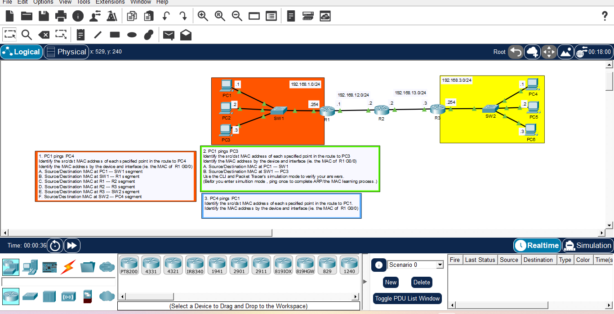

# Day 09: ARP & MAC Address Analysis Across Networks

## Course Reference
- Course: Jeremy's IT Lab - CCNA 200-301
- Topic: ARP, MAC Address, and Packet Flow Across Multiple Networks

## Objective
Analyze the source/destination MAC addresses at each point in the path when PC1 pings PC4, and understand how ARP works across multiple networks.

## Network Topology

## Devices Used
| Device | Type | Interface | IP Address |
|--------|------|-----------|------------|
| PC1 | Generic PC | NIC | 192.168.1.1/24 |
| PC2 | Generic PC | NIC | 192.168.1.2/24 |
| PC3 | Generic PC | NIC | 192.168.1.3/24 |
| PC4 | Generic PC | NIC | 192.168.3.1/24 |
| PC5 | Generic PC | NIC | 192.168.3.2/24 |
| PC6 | Generic PC | NIC | 192.168.3.3/24 |
| R1 | Router | G0/0 | 192.168.1.254/24 |
| R1 | Router | G0/1 | 192.168.12.1/24 |
| R2 | Router | G0/0 | 192.168.12.2/24 |
| R2 | Router | G0/1 | 192.168.13.2/24 |
| R3 | Router | G0/0 | 192.168.13.3/24 |
| R3 | Router | G0/1 | 192.168.3.254/24 |

## Analysis: PC1 ping PC4

### Path: PC1 --> SW1 --> R1 --> R2 --> R3 --> SW2 --> PC4

| Point | Source MAC | Destination MAC | Reason |
|-------|------------|-----------------|--------|
| **A. PC1 --> SW1** | PC1 | R1 G0/0 | PC1 sends to its default gateway |
| **B. SW1 --> R1** | PC1 | R1 G0/0 | Switch forwards frame unchanged |
| **C. R1 --> R2** | R1 G0/1 | R2 G0/0 | R1 rewrites MAC for next hop |
| **D. R2 --> R3** | R2 G0/1 | R3 G0/0 | R2 rewrites MAc for next hop |
| **E. R3 --> SW2** | R3 G0/1 | PC4 | R3 sends to destination PC |
| **F. SW2 --> PC4** | R3 G0/1 | PC4 | Switch forwards to PC4 |
### What I Learned 
1. ARP resolves IP to MAC addresses.
2. MAC addresses change at every router hop.
3. IP addresses remain constant end-to-end.
4. Switches forward frames without changing MAC addresses.
5. Routers rewrite MAC addresses at each hop.
6. Default gateway is used to reach remote networks. 

---