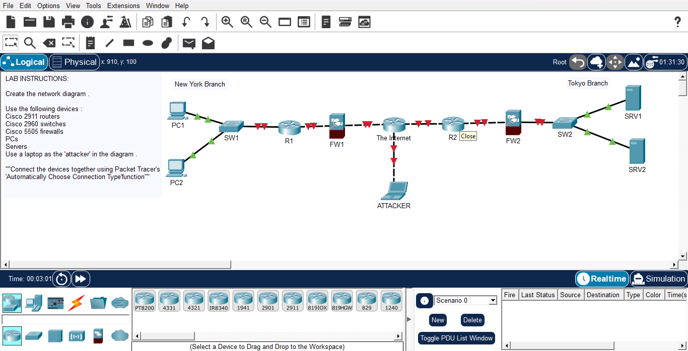

# Day 01: Basic Network Topology - New york & Tokyo Branches

## Course Reference
-**Course**: Jermy's IT Lab - CCNA
-**Topic**: Network Devices & Topology Design

## OBjective
Create a network diagram that connects two brache offices (New york and tokyo) througt the internet, using Cisco routers, switches, and firewalls. Also, include an "attacker" laptop to simulate a real-world scenario.

## Network Topology

## Devices Used

| Device | Model | Quantity | Location |
|--------|-------|----------|----------|
| **Router** | Cisco 2911 | 2 | New york , Tokyo |
| **Switch** | Cisco 2960 | 2 | New york , Tokyo |
| **Firewall** | Cisco 5505 | 2 | New york , Tokyo |
| **PC** | Generic | 2 | New york |
| **Laptop** | Generic | 1 | Attacker (Internet) |

## Steps

1. Placed all required devices in the workspace.
2. Connected devices using **Automaticaly Choose Connection Type**.
3. Build the New York Branch:
    -PC1 and PC2 connected to SW1.
    -SW1 connected to R1.
    -R1 connected to FW1.
4. Built the tokyo Brach:
    - FW2 connected to SW2.
    - SW2 connected to servers.
5. Connected both branches to **The Internet**.
6. Connected the **Attacker** laptop to the Internet to simulate an external threat.

## What I Learned
1. How to **plan a network topology** befor connecting devies.
2. The role of **firewalls** between the internal network and the internet.
3. The importance of **segmentation** (New york, tokyo).
4. How to simulate an **External attacker** in a network diagram.
5. Using Packet Tracer's **Automatically Choose Connection Type** feature.

----
