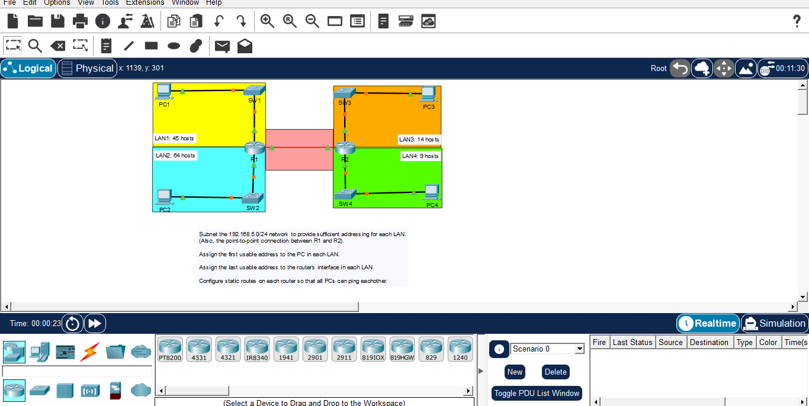

# Day 10: Subnetting & Static Routing Challenge

## Course Reference
- Course: Jeremy's IT Lab - CCNA 200-301
- Topic: Subnetting, IP Addressing, and Static Routing

## Objective
Subnet the 192.168.5.0/24 network to provide sufficient addressing for 4 LANs and 1 point-to-point link, then configure static routes so all PCs can ping each other.

## Network Topology

## Requirements

| Network | Hosts Required | Subnet Size |
|---------|----------------|-------------|
| LAN 1 | 45 hosts | /26 (62 hosts) |
| LAN 2 | 64 hosts | /25 (126 hosts) |
| LAN 3 | 14 hosts | /28 (14 hosts) |
| LAN 4 | 9 hosts | /28 (14 hosts) |
| R1-R2 Link | 2 hosts | /30 (2 hosts) |

## Subnetting Plan

Base Network: 192.168.5.0/24

| Subnet | Network | Mask | Usable Range | Broadcast |
|--------|---------|------|--------------|-----------|
| LAN 2 | 192.168.5.0/25 | 255.255.255.128 | .1 - .126 | .127 |
| LAN 1 | 192.168.5.128/26 | 255.255.255.192 | .129 - .190 | .191 |
| LAN 3 | 192.168.5.192/28 | 255.255.255.240 | .193 - .206 | .207 |
| LAN 4 | 192.168.5.208/28 | 255.255.255.240 | .209 - .222 | .223 |
| R1-R2 | 192.168.5.224/30 | 255.255.255.252 | .225 - .226 | .227 |

## IP Address Assignment

### LAN 1 (192.168.5.128/26)
- PC1: 192.168.5.129/26 (first usable)
- R1 G0/0: 192.168.5.190/26 (last usable)

### LAN 2 (192.168.5.0/25)
- PC2: 192.168.5.1/25 (first usable)
- R1 G0/1: 192.168.5.126/25 (last usable)

### LAN 3 (192.168.5.192/28)
- PC3: 192.168.5.193/28 (first usable)
- R2 G0/0: 192.168.5.206/28 (last usable)

### LAN 4 (192.168.5.208/28)
- PC4: 192.168.5.209/28 (first usable)
- R2 G0/1: 192.168.5.222/28 (last usable)

### R1-R2 Link (192.168.5.224/30)
- R1 G0/2: 192.168.5.225/30
- R2 G0/2: 192.168.5.226/30

## Configuration Steps

### Step 1: Configure R1
enable
configure terminal
hostname R1

interface GigabitEthernet0/0
 ip address 192.168.5.190 255.255.255.192
 no shutdown
 exit

interface GigabitEthernet0/1
 ip address 192.168.5.126 255.255.255.128
 no shutdown
 exit

interface GigabitEthernet0/2
 ip address 192.168.5.225 255.255.255.252
 no shutdown
 exit

### Step 2: Configure R2
enable
configure terminal
hostname R2

interface GigabitEthernet0/0
 ip address 192.168.5.206 255.255.255.240
 no shutdown
 exit

interface GigabitEthernet0/1
 ip address 192.168.5.222 255.255.255.240
 no shutdown
 exit

interface GigabitEthernet0/2
 ip address 192.168.5.226 255.255.255.252
 no shutdown
 exit

### Step 3: Configure Static Routes

On R1:
ip route 192.168.5.192 255.255.255.240 192.168.5.226
ip route 192.168.5.208 255.255.255.240 192.168.5.226

On R2:
ip route 192.168.5.0 255.255.255.128 192.168.5.225
ip route 192.168.5.128 255.255.255.192 192.168.5.225

### Step 4: Configure PCs
- PC1: IP 192.168.5.129, Mask 255.255.255.192, Gateway 192.168.5.190
- PC2: IP 192.168.5.1, Mask 255.255.255.128, Gateway 192.168.5.126
- PC3: IP 192.168.5.193, Mask 255.255.255.240, Gateway 192.168.5.206
- PC4: IP 192.168.5.209, Mask 255.255.255.240, Gateway 192.168.5.222

### Step 5: Save Configuration
On all routers:
copy running-config startup-config

### Step 6: Test Connectivity
From PC1:
ping 192.168.5.1
ping 192.168.5.193
ping 192.168.5.209

## What I Learned
1. VLSM (Variable Length Subnet Masking): Using different subnet sizes based on host requirements.
2. Subnet Planning: Starting with the largest subnet first (LAN 2 - 64 hosts).
3. First/Last Usable Addresses: Assigning first to PCs, last to router interfaces.
4. Point-to-Point Links: Using /30 subnet (2 usable addresses) for router-to-router connections.
5. Static Routing: Configuring routes to reach remote subnets.
6. Route Summarization: Each router needs routes to all remote subnets.

---
