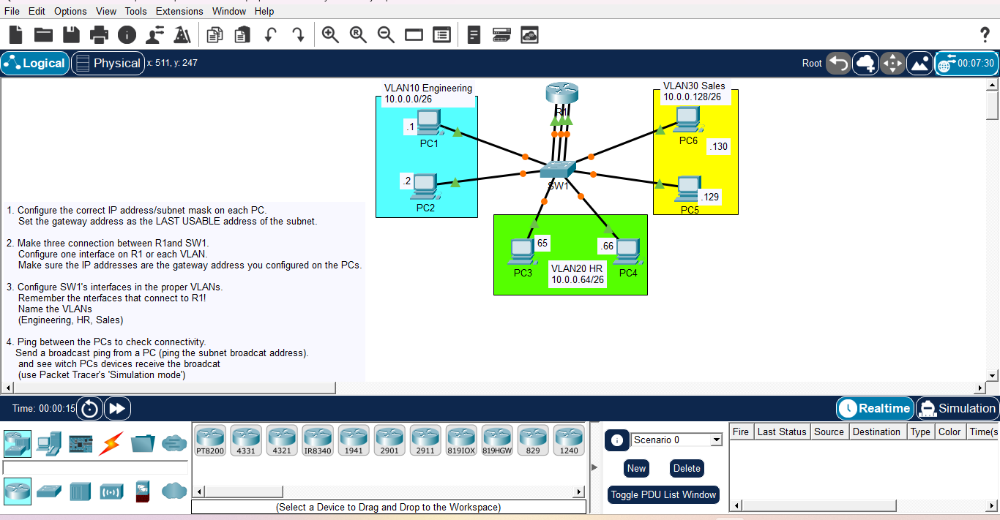

# Day 11: Inter-VLAN Routing (Router-on-a-Stick)

## Course Reference
- Course: Jeremy's IT Lab - CCNA 200-301
- Topic: Inter-VLAN Routing, Trunking, and Subinterfaces

## Objective
Configure Inter-VLAN routing using the "Router-on-a-Stick" method. Configure VLANs on a switch, create subinterfaces on a router, and test connectivity between different VLANs.

## Network Topology

## Devices Used
| Device | Type | VLAN | IP Address | Subnet Mask |
|--------|------|------|------------|-------------|
| PC1 | PC | 10 (Engineering) | 10.0.0.1 | 255.255.255.192 |
| PC2 | PC | 10 (Engineering) | 10.0.0.2 | 255.255.255.192 |
| PC3 | PC | 20 (HR) | 10.0.0.65 | 255.255.255.192 |
| PC4 | PC | 20 (HR) | 10.0.0.66 | 255.255.255.192 |
| PC5 | PC | 30 (Sales) | 10.0.0.129 | 255.255.255.192 |
| PC6 | PC | 30 (Sales) | 10.0.0.130 | 255.255.255.192 |
| R1 | Router | - | - | - |
| SW1 | Switch | - | - | - |

## Subnetting Plan (10.0.0.0/24)
| VLAN | Subnet | Usable Range | Gateway (Last Usable) |
|------|--------|--------------|-----------------------|
| 10 | 10.0.0.0/26 | 10.0.0.1 - 10.0.0.62 | 10.0.0.62 |
| 20 | 10.0.0.64/26 | 10.0.0.65 - 10.0.0.126 | 10.0.0.126 |
| 30 | 10.0.0.128/26 | 10.0.0.129 - 10.0.0.190 | 10.0.0.190 |

## Configuration Steps

### Step 1: Configure PCs (IP & Gateway)
- PC1: IP 10.0.0.1, Mask 255.255.255.192, Gateway 10.0.0.62
- PC2: IP 10.0.0.2, Mask 255.255.255.192, Gateway 10.0.0.62
- PC3: IP 10.0.0.65, Mask 255.255.255.192, Gateway 10.0.0.126
- PC4: IP 10.0.0.66, Mask 255.255.255.192, Gateway 10.0.0.126
- PC5: IP 10.0.0.129, Mask 255.255.255.192, Gateway 10.0.0.190
- PC6: IP 10.0.0.130, Mask 255.255.255.192, Gateway 10.0.0.190

### Step 2: Configure R1 (Router-on-a-Stick)
enable
configure terminal
hostname R1

interface GigabitEthernet0/0
 no shutdown
 exit

interface GigabitEthernet0/0.10
 encapsulation dot1Q 10
 ip address 10.0.0.62 255.255.255.192
 exit

interface GigabitEthernet0/0.20
 encapsulation dot1Q 20
 ip address 10.0.0.126 255.255.255.192
 exit

interface GigabitEthernet0/0.30
 encapsulation dot1Q 30
 ip address 10.0.0.190 255.255.255.192
 exit

### Step 3: Configure SW1 (VLANs & Trunking)
enable
configure terminal
hostname SW1

vlan 10
 name Engineering
vlan 20
 name HR
vlan 30
 name Sales

interface range FastEthernet0/1-2
 switchport mode access
 switchport access vlan 10
 exit

interface range FastEthernet0/3-4
 switchport mode access
 switchport access vlan 20
 exit

interface range FastEthernet0/5-6
 switchport mode access
 switchport access vlan 30
 exit

interface GigabitEthernet0/1
 switchport mode trunk
 exit

### Step 4: Test Connectivity
From PC1:
ping 10.0.0.65 (PC3)
ping 10.0.0.129 (PC5)

### Step 5: Broadcast Ping (Simulation Mode)
From PC1:
ping 10.0.0.63 (Broadcast address of VLAN 10)

**Observation:** Only devices in VLAN 10 (PC1 and PC2) receive the broadcast. Devices in VLAN 20 and 30 do NOT receive it.

## What I Learned
1. Inter-VLAN Routing: Allows devices in different VLANs to communicate.
2. Router-on-a-Stick: Uses a single physical router interface with multiple subinterfaces.
3. 802.1Q Encapsulation: Tags frames with VLAN IDs for trunking.
4. Trunk Port: Carries traffic for multiple VLANs between switches/routers.
5. Broadcast Domains: Broadcasts are confined to a single VLAN (Layer 2 boundary).
6. Gateway: Must be the router's subinterface IP for each VLAN.

---