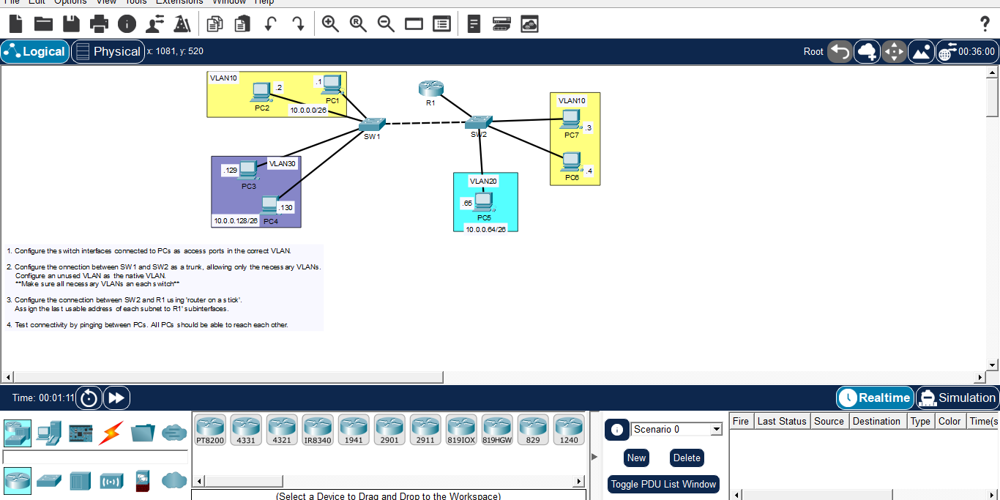

# Day 12: VLANs, Trunking & Router-on-a-Stick (Multi-Switch)

## Course Reference
- Course: Jeremy's IT Lab - CCNA 200-301
- Topic: Inter-VLAN Routing across multiple switches, Trunking, and Native VLAN

## Objective
Configure a multi-switch topology with VLANs, configure trunk links with allowed VLANs, set a native VLAN, and enable inter-VLAN routing using Router-on-a-Stick.

## Network Topology

## Devices & VLAN Mapping
| Device | VLAN | IP Address | Subnet | Gateway (R1) |
|--------|------|------------|--------|--------------|
| PC1, PC2 | 10 | 10.0.0.1, 10.0.0.2 | /26 | 10.0.0.62 |
| PC5 | 20 | 10.0.0.65 | /26 | 10.0.0.126 |
| PC3, PC4 | 30 | 10.0.0.129, 10.0.0.130 | /26 | 10.0.0.190 |
| PC7, PC8 | 10 | (Same subnet as PC1) | /26 | 10.0.0.62 |

## Configuration Steps

### Step 1: Configure Access Ports on Switches

**On SW1:**
interface range FastEthernet0/1-2
 switchport mode access
 switchport access vlan 10
 exit
interface range FastEthernet0/3-4
 switchport mode access
 switchport access vlan 30
 exit

**On SW2:**
interface range FastEthernet0/1-2
 switchport mode access
 switchport access vlan 10
 exit
interface FastEthernet0/3
 switchport mode access
 switchport access vlan 20
 exit

### Step 2: Configure Trunk between SW1 and SW2
*Note: The instruction says to allow only necessary VLANs, and set an unused VLAN as the native VLAN (e.g., VLAN 99).*

**On SW1 (G0/1):**
interface GigabitEthernet0/1
 switchport mode trunk
 switchport trunk allowed vlan 10,20,30
 switchport trunk native vlan 99
 exit

**On SW2 (G0/1):**
interface GigabitEthernet0/1
 switchport mode trunk
 switchport trunk allowed vlan 10,20,30
 switchport trunk native vlan 99
 exit

### Step 3: Configure Router-on-a-Stick (R1)
*Assigning the last usable address of each subnet to R1.*

**On R1:**
interface GigabitEthernet0/0
 no shutdown
 exit

interface GigabitEthernet0/0.10
 encapsulation dot1Q 10
 ip address 10.0.0.62 255.255.255.192
 exit

interface GigabitEthernet0/0.20
 encapsulation dot1Q 20
 ip address 10.0.0.126 255.255.255.192
 exit

interface GigabitEthernet0/0.30
 encapsulation dot1Q 30
 ip address 10.0.0.190 255.255.255.192
 exit

### Step 4: Test Connectivity
From PC1 (VLAN 10):
ping 10.0.0.65 (PC5 in VLAN 20)
ping 10.0.0.129 (PC3 in VLAN 30)

## What I Learned
1. Multi-Switch VLANs: VLANs must be manually created on all switches in the network.
2. Trunking: Trunk links carry traffic for multiple VLANs between switches.
3. Allowed VLANs: `switchport trunk allowed vlan` restricts which VLANs can traverse the trunk.
4. Native VLAN: Untagged traffic is assigned to the native VLAN (must match on both ends of the trunk).
5. Router-on-a-Stick: Single physical interface divided into subinterfaces for routing between VLANs.
6. Last Usable Address: Used as the default gateway for end devices.

---
