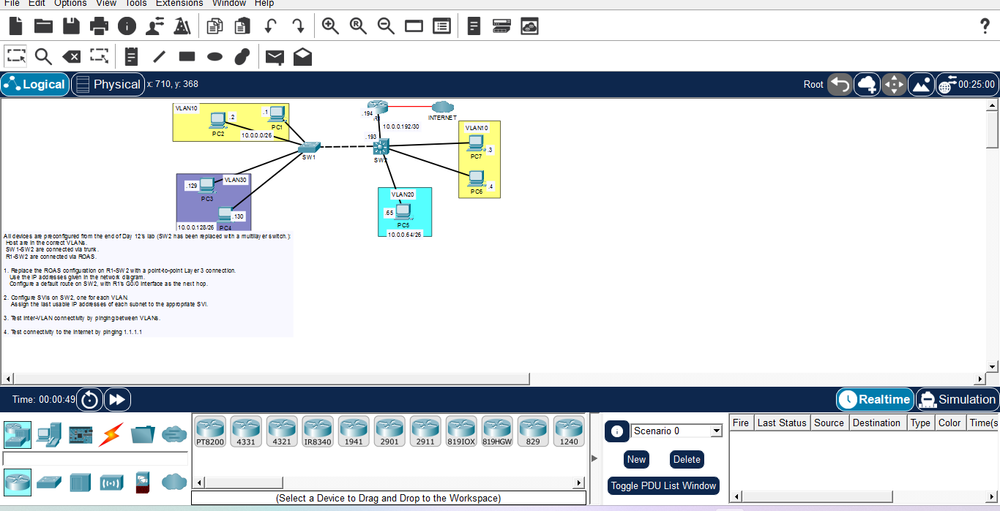

# Day 13: Inter-VLAN Routing with Multilayer Switch (SVIs)

## Course Reference
- Course: Jeremy's IT Lab - CCNA 200-301
- Topic: Layer 3 Switching, Switch Virtual Interfaces (SVIs), and Point-to-Point Layer 3 Links

## Objective
Replace the Router-on-a-Stick (ROAS) configuration with a Multilayer Switch (SW2). Configure Switch Virtual Interfaces (SVIs) for inter-VLAN routing and a routed port for the connection to R1.

## Network Topology

## Devices & IP Addressing
| Device | VLAN | IP Address | Subnet | Gateway |
|--------|------|------------|--------|---------|
| PC1, PC2 | 10 | 10.0.0.1, 10.0.0.2 | /26 | 10.0.0.62 |
| PC5 | 20 | 10.0.0.65 | /26 | 10.0.0.126 |
| PC3, PC4 | 30 | 10.0.0.129, 10.0.0.130 | /26 | 10.0.0.190 |
| PC7, PC8 | 10 | (Same subnet) | /26 | 10.0.0.62 |
| SW2 (SVI 10) | 10 | 10.0.0.62 | /26 | - |
| SW2 (SVI 20) | 20 | 10.0.0.126 | /26 | - |
| SW2 (SVI 30) | 30 | 10.0.0.190 | /26 | - |
| R1 (G0/0) | - | 10.0.0.194 | /30 | - |
| SW2 (Routed Port) | - | 10.0.0.193 | /30 | - |

## Configuration Steps

### Step 1: Enable IP Routing on SW2
enable
configure terminal
ip routing

### Step 2: Configure SVIs on SW2 (Assign Last Usable IP)
interface vlan 10
 ip address 10.0.0.62 255.255.255.192
 no shutdown
 exit

interface vlan 20
 ip address 10.0.0.126 255.255.255.192
 no shutdown
 exit

interface vlan 30
 ip address 10.0.0.190 255.255.255.192
 no shutdown
 exit

### Step 3: Configure Point-to-Point Layer 3 Link (SW2 to R1)
*Note: The interface connecting to R1 must be converted from a switchport to a routed port.*

interface GigabitEthernet1/0/1
 no switchport
 ip address 10.0.0.193 255.255.255.252
 no shutdown
 exit

### Step 4: Configure Default Route on SW2
*Point the default route to R1's IP address.*

ip route 0.0.0.0 0.0.0.0 10.0.0.194

### Step 5: Test Connectivity
From PC1 (VLAN 10):
ping 10.0.0.65 (PC5 in VLAN 20)
ping 10.0.0.129 (PC3 in VLAN 30)
ping 1.1.1.1 (Internet)

## What I Learned
1. Multilayer Switch: Can perform both Layer 2 switching and Layer 3 routing.
2. SVI (Switch Virtual Interface): A virtual interface used for routing traffic between VLANs on a multilayer switch.
3. IP Routing: `ip routing` command is required to enable Layer 3 routing on a switch.
4. Routed Port: `no switchport` converts a physical switch port into a Layer 3 routed port.
5. Point-to-Point Link: Using a /30 subnet for the connection between the switch and the router.
6. Default Route: `ip route 0.0.0.0 0.0.0.0 [next-hop]` sends all unknown traffic to the next router.

---