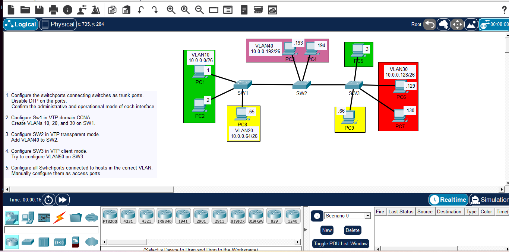

# Day 14: VTP (VLAN Trunking Protocol) Configuration

## Course Reference
- Course: Jeremy's IT Lab - CCNA 200-301
- Topic: VTP Modes (Server, Client, Transparent), Trunking, and DTP

## Objective
Configure VTP to manage VLANs across multiple switches, understand VTP modes, and disable DTP on trunk ports.

## Network Topology

## Devices Used
| Device | Type | VTP Mode | VLANs Configured |
|--------|------|----------|------------------|
| SW1 | Switch | Server | 10, 20, 30 |
| SW2 | Switch | Transparent | 10, 20, 30, 40 |
| SW3 | Switch | Client | (Learns from SW1) |

## Configuration Steps

### Step 1: Configure Trunk Ports and Disable DTP
*DTP (Dynamic Trunking Protocol) can be a security risk. We disable it by manually configuring the ports as trunks.*

**On SW1, SW2, and SW3 (on ports connecting switches):**
interface range GigabitEthernet0/1-2
 switchport trunk encapsulation dot1q
 switchport mode trunk
 switchport nonegotiate
 exit

*Verify:*
show interfaces trunk

### Step 2: Configure SW1 as VTP Server
enable
configure terminal
vtp mode server
vtp domain CCNA
vtp version 2

*Create VLANs (These will be advertised to other switches):*
vlan 10
 name VLAN10
vlan 20
 name VLAN20
vlan 30
 name VLAN30

### Step 3: Configure SW2 as VTP Transparent
enable
configure terminal
vtp mode transparent
vtp domain CCNA

*Add a local VLAN (It won't be advertised to other switches):*
vlan 40
 name VLAN40

### Step 4: Configure SW3 as VTP Client
enable
configure terminal
vtp mode client
vtp domain CCNA

*Verify:*
show vtp status
show vlan brief
*(SW3 should automatically learn VLANs 10, 20, and 30 from SW1).*

### Step 5: Configure Access Ports (Hosts)
**On SW1:**
interface range FastEthernet0/1-2
 switchport mode access
 switchport access vlan 10
 exit

**On SW2:**
interface FastEthernet0/1
 switchport mode access
 switchport access vlan 40
 exit

interface FastEthernet0/2
 switchport mode access
 switchport access vlan 20
 exit

**On SW3:**
interface FastEthernet0/1
 switchport mode access
 switchport access vlan 20
 exit

interface range FastEthernet0/2-3
 switchport mode access
 switchport access vlan 30
 exit

### Step 6: Test VTP Behavior
Try to configure VLAN 50 on SW3 (Client mode):
vlan 50
*Result: You will get an error "VTP VLAN configuration not allowed when device is in CLIENT mode".*

## What I Learned
1. VTP (VLAN Trunking Protocol): Automatically synchronizes VLAN databases across switches.
2. VTP Server: Can create, modify, and delete VLANs, and advertises them.
3. VTP Client: Cannot create VLANs locally; learns them from the server.
4. VTP Transparent: Does not participate in VTP updates. It can create local VLANs but does not advertise them.
5. DTP (Dynamic Trunking Protocol): Automatically negotiates trunk links. Disabling it (`switchport nonegotiate`) improves security.
6. VTP Domain: All switches must be in the same domain to share VLAN information.

---