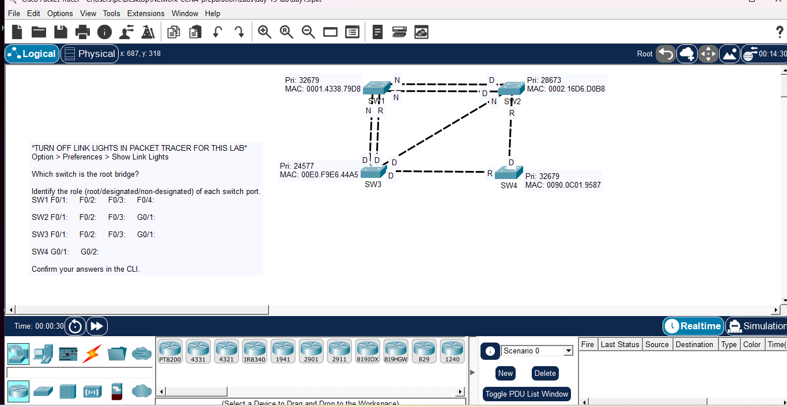

# Day 15: Spanning Tree Protocol (STP) Analysis

## Course Reference
- Course: Jeremy's IT Lab - CCNA 200-301
- Topic: STP (Spanning Tree Protocol), Root Bridge Election, and Port Roles

## Objective
Analyze an STP topology, determine the Root Bridge based on Bridge ID (Priority + MAC), and identify the role of each switch port (Root, Designated, Non-Designated/Blocking).

## Network Topology

## Switch Information & Bridge ID (BID)
| Switch | Priority | MAC Address | Bridge ID (BID) |
|--------|----------|-------------|-----------------|
| SW1 | 32679 | 0001.4338.79D8 | 32679.0001.4338.79D8 |
| SW2 | 28673 | 0002.16D6.D0B8 | 28673.0002.16D6.D0B8 |
| SW3 | 24577 | 00E0.F9E6.44A5 | 24577.00E0.F9E6.44A5 |
| SW4 | 32679 | 0090.0C01.9587 | 32679.0090.0C01.9587 |

## Analysis & Answers

### 1. Which switch is the root bridge?
**Answer:** **SW3**
**Reason:** The Root Bridge is elected based on the lowest Bridge ID. The Bridge ID consists of the Priority and the MAC address. SW3 has the lowest Priority (24577), so it wins the election immediately, regardless of the MAC address.

### 2. Identify the role of each switch port

| Switch | Port | Role | Reason |
|--------|------|------|--------|
| **SW1** | F0/1 | Root (R) | Best path to the Root Bridge (SW3). |
| | F0/2 | Designated (D) | Forwarding traffic towards SW2. |
| | F0/3 | Designated (D) | Forwarding traffic towards SW3. |
| | F0/4 | Designated (D) | Forwarding traffic towards SW4 (assumed based on topology). |
| **SW2** | F0/1 | Non-Designated (N) | Blocking port. It has a higher path cost to the root via SW1/SW4. |
| | F0/2 | Non-Designated (N) | Blocking port. |
| | F0/3 | Root (R) | Best path to the Root Bridge (SW3) directly. |
| | G0/1 | Designated (D) | Forwarding traffic towards SW4. |
| **SW3** | F0/1 | Designated (D) | The Root Bridge's ports are all Designated. |
| | F0/2 | Designated (D) | The Root Bridge's ports are all Designated. |
| | F0/3 | Designated (D) | The Root Bridge's ports are all Designated. |
| | G0/1 | Designated (D) | The Root Bridge's ports are all Designated. |
| **SW4** | G0/1 | Root (R) | Best path to the Root Bridge (SW3). |
| | G0/2 | Designated (D) | Forwarding traffic towards SW2. |

## What I Learned
1. Root Bridge Election: The switch with the lowest Bridge ID (Priority + MAC) becomes the Root Bridge.
2. Default STP Priority: 32768. Priorities are adjusted in increments of 4096.
3. Port Roles:
   - Root Port (R): The port with the lowest cost to the Root Bridge (1 per non-root switch).
   - Designated Port (D): Forwarding port. All ports on the Root Bridge are Designated.
   - Non-Designated/Blocking Port (N): Prevents loops by blocking redundant paths.
4. Path Cost: Based on bandwidth (e.g., 100 Mbps = cost 19, 1 Gbps = cost 4).
5. Topology Changes: STP prevents Layer 2 loops which cause broadcast storms.

---