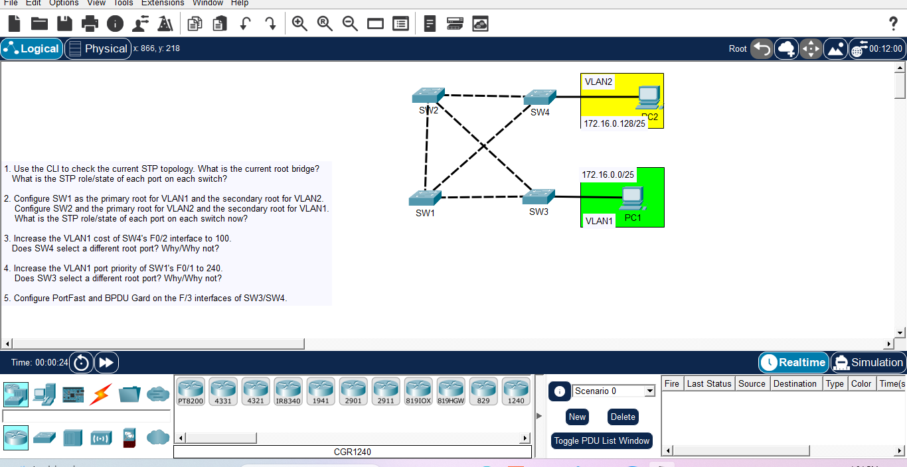

# Day 16: Spanning Tree Protocol (STP) Manipulation & PortFast

## Course Reference
- Course: Jeremy's IT Lab - CCNA 200-301
- Topic: STP Root Bridge Election, Path Cost, Port Priority, PortFast, and BPDU Guard

## Objective
Analyze the default STP topology, manually configure the Root Bridge and Secondary Root Bridge for specific VLANs, manipulate path costs and port priorities to force STP topology changes, and configure PortFast and BPDU Guard on access ports.

## Network Topology

## Devices & VLAN Mapping
| Device | VLAN | IP Address | Subnet | Gateway |
|--------|------|------------|--------|---------|
| PC1 | VLAN1 | 172.16.0.1 | /25 | - |
| PC2 | VLAN2 | 172.16.0.129 | /25 | - |
| SW1 - SW4 | - | - | - | - |

##  Analysis & Configuration Steps

### 1. Default STP Topology Analysis
*   **Current Root Bridge:** The switch with the lowest Bridge ID (Priority + MAC). By default, all switches have a priority of 32768, so the switch with the lowest MAC address becomes the Root Bridge (likely SW1 or SW2 depending on MACs).
*   **Port Roles:**
    *   **Root Bridge:** All ports are Designated (Forwarding).
    *   **Non-Root Bridges:** One Root Port (lowest cost to root), Designated Ports, and Blocking Ports (to prevent loops).

### 2. Configuring Primary and Secondary Root Bridges
We want SW1 to be the Primary Root for VLAN1 and Secondary for VLAN2. SW2 will be Primary for VLAN2 and Secondary for VLAN1.

**On SW1:**
spanning-tree vlan 1 root primary
spanning-tree vlan 2 root secondary

**On SW2:**
spanning-tree vlan 2 root primary
spanning-tree vlan 1 root secondary

*Result:* SW1's priority for VLAN1 drops to 24576, making it the Root. SW2's priority for VLAN2 drops to 24576, making it the Root for VLAN2.

### 3. Increasing the VLAN1 Cost of SW4's F0/2 to 100
**On SW4:**
interface FastEthernet0/2
spanning-tree vlan 1 cost 100
exit
*Result:* The path cost increases. SW4 will evaluate if the current Root Port is still the best path. It will likely switch its Root Port to another interface (e.g., F0/1) if the new cost makes the path through F0/1 cheaper.

### 4. Increasing VLAN1 Port Priority of SW1's F0/1 to 240
**On SW1:**
interface FastEthernet0/1
spanning-tree vlan 1 port-priority 240
exit
*Result:* This affects the Designated Port election. If SW1 and SW2 are both connected to SW3, SW1's port priority changes which switch becomes the Designated Port for that segment. SW3 will select the root port based on the best BPDU. If SW1's port priority is worse (higher number), SW3 might choose SW2 as the Designated Port for that segment, changing its Root Port selection.

### 5. Configuring PortFast and BPDU Guard
*PortFast* allows access ports to transition immediately to Forwarding (bypassing Listening and Learning states). *BPDU Guard* disables the port if a BPDU is received (preventing loops if a switch is accidentally connected).

**On SW3 and SW4 (F0/3 interfaces connected to PCs):**
interface FastEthernet0/3
spanning-tree portfast
spanning-tree bpduguard enable
exit

## What I Learned
1.  **Root Bridge Election:** Lowest Priority wins. If tie, lowest MAC wins.
2.  **Root Primary/Secondary:** Commands `root primary` and `root secondary` are macros that adjust the priority to ensure the switch becomes the root or backup root.
3.  **Path Cost:** Lower cost is preferred. Modifying cost can force STP to block/unblock different ports.
4.  **Port Priority:** Used as a tiebreaker when path costs are equal. Lower priority is better.
5.  **PortFast:** Bypasses STP listening/learning states for access ports, speeding up PC connection.
6.  **BPDU Guard:** Protects against rogue switches by disabling the port if BPDUs are received.

---
