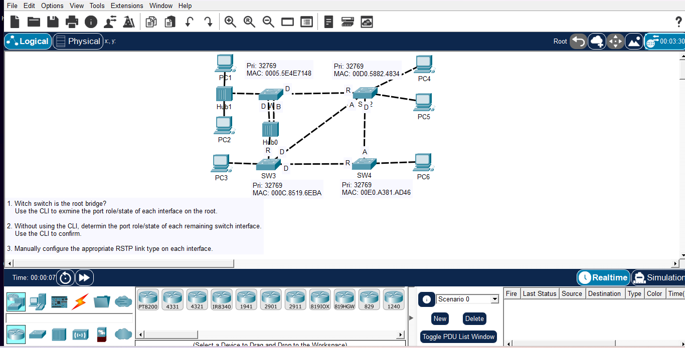

# Day 17: Rapid Spanning Tree Protocol (RSTP) Analysis & Configuration

## Course Reference
- Course: Jeremy's IT Lab - CCNA 200-301
- Topic: RSTP Root Bridge Election, Port Roles, Port States, and Link Types

## Objective
Analyze an RSTP topology to determine the Root Bridge, identify port roles/states across all switches, and manually configure RSTP link types.

## Network Topology

## Switch Information & Bridge ID (BID)
| Switch | Priority | MAC Address | Bridge ID (BID) |
|--------|----------|-------------|-----------------|
| SW1 (Hub1) | 32769 | 0005.5E4E7148 | 32769.0005.5E4E7148 |
| SW2 (Hub0) | 32769 | 0000.5882.4834 | 32769.0000.5882.4834 |
| SW3 | 32769 | 000C.8519.6EBA | 32769.000C.8519.6EBA |
| SW4 | 32769 | 00E0.A381.AD46 | 32769.00E0.A381.AD46 |

## Analysis & Answers

### 1. Which switch is the root bridge?
**Answer:** **SW2 (Hub0)**
**Reason:** In RSTP (and STP), the Root Bridge is elected based on the lowest Bridge ID. The Bridge ID consists of the Priority and the MAC address. All switches have the same Priority (32769), so the switch with the lowest MAC address wins. SW2 has the lowest MAC address (0000.5882.4834).

### 2. Without using the CLI, determine the port role/state of each remaining switch interface. Use the CLI to confirm.

*   **Root Bridge (SW2):**
    *   All ports are **Designated (Forwarding)**.

*   **SW1:**
    *   Interface connected to SW2: **Root Port (Forwarding)** (Best path to root).
    *   Interface connected to SW3: **Designated (Forwarding)**.

*   **SW3:**
    *   Interface connected to SW1: **Root Port (Forwarding)** (Best path to root via SW1).
    *   Interface connected to SW4: **Designated (Forwarding)**.
    *   Interface connected to Hub0 (SW2): **Alternate (Discarding)** (This path creates a loop and has a higher cost).

*   **SW4:**
    *   Interface connected to SW3: **Root Port (Forwarding)** (Best path to root).
    *   Interface connected to SW2: **Alternate (Discarding)** (Higher cost path to root).

### 3. Manually configure the appropriate RSTP link type on each interface.
*   **Edge Ports (PortFast equivalent):** Interfaces connected to PCs should be configured as edge ports to bypass STP negotiation.
*   **Point-to-Point Links:** Interfaces connecting switches (Full Duplex) should be point-to-point.
*   **Shared Links:** Interfaces connecting to a Hub should be shared.

**Configuration Commands (Example on SW1):**
interface FastEthernet0/1
spanning-tree link-type point-to-point
exit
interface FastEthernet0/2
spanning-tree link-type shared
exit
interface FastEthernet0/3
spanning-tree portfast
spanning-tree link-type edge
exit

## What I Learned
1.  **RSTP vs STP:** RSTP converges much faster than traditional STP by using different port states (Discarding, Learning, Forwarding) and link types.
2.  **Root Bridge Election:** Still based on the lowest Bridge ID (Priority + MAC).
3.  **Port Roles:**
    *   **Root Port:** Best path to the root bridge.
    *   **Designated Port:** Forwarding port for a segment.
    *   **Alternate Port:** Blocked port that provides an alternative path to the root.
4.  **Port States in RSTP:** Discarding (blocked), Learning, Forwarding.
5.  **Link Types:** Point-to-Point (switch-to-switch), Shared (switch-to-hub), Edge (switch-to-PC).
6.  **Edge Ports (PortFast):** Speed up connection for end devices by skipping STP learning.

---