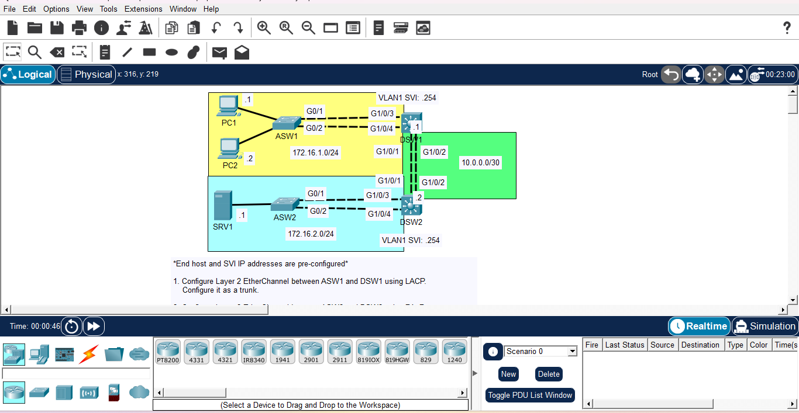

# Day 18: Layer 2 & Layer 3 EtherChannel Configuration

## Course Reference
This lab is part of **Jeremy's IT Lab** — CCNA 200-301 (Cisco Certified Network Associate) course.

## Objective
Configure Layer 2 and Layer 3 EtherChannels using LACP, PAgP, and static modes to increase bandwidth and redundancy. Additionally, configure routing between distinct network segments and optimize EtherChannel load-balancing.

## Network Topology

## Devices Used

| Device | Type | IP Address | Role |
|--------|------|------------|------|
| DSW1 | Multilayer Switch | VLAN 1 SVI: 172.16.1.254/24 | Distribution Switch (Top) |
| DSW2 | Multilayer Switch | VLAN 1 SVI: 172.16.2.254/24 | Distribution Switch (Bottom) |
| ASW1 | Access Switch | N/A | Access Switch for PC1 & PC2 |
| ASW2 | Access Switch | N/A | Access Switch for SRV1 |
| PC1 | Host | 172.16.1.1/24 | End User |
| PC2 | Host | 172.16.1.2/24 | End User |
| SRV1 | Server | 172.16.2.1/24 | Internal Server |

*Note: The `10.0.0.0/30` network represents the Layer 3 link between DSW1 and DSW2 via their routed EtherChannel.*

## Configuration Steps

### Task 1: Layer 2 EtherChannel between ASW1 and DSW1 (LACP)
**On ASW1 (Active mode):**

    configure terminal
    interface range g0/1 - 2
     channel-group 1 mode active
    exit
    interface port-channel 1
     switchport trunk encapsulation dot1q
     switchport mode trunk

**On DSW1 (Passive mode):**

    configure terminal
    interface range g1/0/3 - 4
     channel-group 1 mode passive
    exit
    interface port-channel 1
     switchport trunk encapsulation dot1q
     switchport mode trunk

### Task 2: Layer 2 EtherChannel between ASW2 and DSW2 (PAgP)
**On ASW2 (Desirable mode):**

    configure terminal
    interface range g0/1 - 2
     channel-group 2 mode desirable
    exit
    interface port-channel 2
     switchport trunk encapsulation dot1q
     switchport mode trunk

**On DSW2 (Auto mode):**

    configure terminal
    interface range g1/0/3 - 4
     channel-group 2 mode auto
    exit
    interface port-channel 2
     switchport trunk encapsulation dot1q
     switchport mode trunk

### Task 3: Layer 3 EtherChannel between DSW1 and DSW2 (Static)
**On DSW1:**

    configure terminal
    interface range g1/0/1 - 2
     no switchport
     channel-group 3 mode on
    exit
    interface port-channel 3
     ip address 10.0.0.1 255.255.255.252
     no shutdown

**On DSW2:**

    configure terminal
    interface range g1/0/1 - 2
     no switchport
     channel-group 3 mode on
    exit
    interface port-channel 3
     ip address 10.0.0.2 255.255.255.252
     no shutdown

### Task 4: Routing to allow PCs to reach SRV1
**On DSW1:**

    configure terminal
    ip routing
    ip route 172.16.2.0 255.255.255.0 10.0.0.2

**On DSW2:**

    configure terminal
    ip routing
    ip route 172.16.1.0 255.255.255.0 10.0.0.1

### Task 5 & 6: Load Balancing
By default, Cisco switches typically use `src-mac` for load balancing. We need to change it to use Source and Destination IP addresses.

**On all switches (DSW1, DSW2, ASW1, ASW2):**

    configure terminal
    port-channel load-balance src-dst-ip

## 📚 What I Learned

- **EtherChannel Protocols:** The differences between LACP (open standard), PAgP (Cisco proprietary), and Static (On) modes.
- **Layer 2 vs Layer 3:** How to bundle ports as a switch trunk versus a routed port using the `no switchport` command.
- **Routing on Switches:** Enabling `ip routing` on multilayer switches to route between VLANs and subnets.
- **Load Balancing:** How to verify and change the hashing algorithm used by EtherChannels to optimize traffic distribution.

---