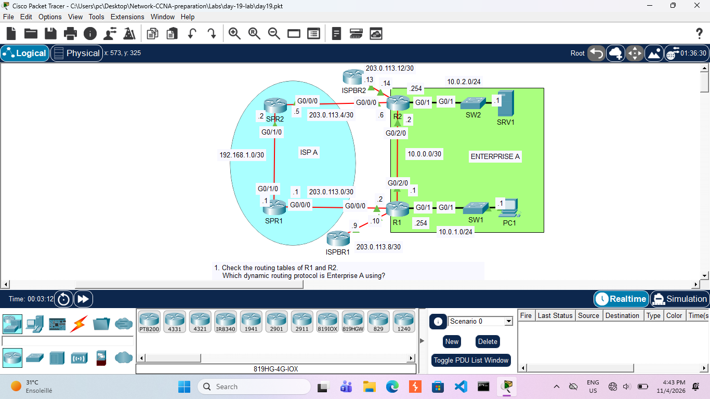

# Day 19: Floating Static Routes & Routing Table Analysis

## Course Reference
This lab is part of **Jeremy's IT Lab** — CCNA 200-301 (Cisco Certified Network Associate) course.

## Objective
Analyze dynamic routing protocols within Enterprise A, verify path selection to internal and external destinations, and configure floating static routes to provide redundancy if the primary link between R1 and R2 fails.

## Network Topology

## Devices Used

| Device | Type | IP Address | Role |
|--------|------|------------|------|
| R1 | Router | 10.0.1.254/24, 10.0.0.1/30, 203.0.113.10/30 | Enterprise A Edge Router (Bottom) |
| R2 | Router | 10.0.2.254/24, 10.0.0.2/30, 203.0.113.6/30 | Enterprise A Edge Router (Top) |
| SPR1 | Router | 203.0.113.9/30, 192.168.1.1/30, 203.0.113.1/30 | ISP A Provider Router (Bottom) |
| SPR2 | Router | 203.0.113.13/30, 203.0.113.5/30, 192.168.1.2/30 | ISP A Provider Router (Top) |
| ISPRB1 | Router | 203.0.113.10/30 | ISP B Router (Bottom) |
| ISPRB2 | Router | 203.0.113.14/30 | ISP B Router (Top) |
| SW1 | Switch | N/A | LAN Switch for PC1 |
| SW2 | Switch | N/A | LAN Switch for SRV1 |
| PC1 | Host | 10.0.1.1/24 | End User (Enterprise A) |
| SRV1 | Server | 10.0.2.1/24 | Internal Server (Enterprise A) |

## Configuration Steps

### Task 1: Routing Table Analysis
*Note: Based on the topology, Enterprise A is likely using OSPF. The primary path between R1 and R2 is via the direct G0/2/0 link.*

### Task 2: Configure Floating Static Routes
We will configure floating static routes on R1 and R2 to route traffic through the ISP network (SPR1/SPR2) if the direct link (`10.0.0.0/30`) goes down. We set the Administrative Distance (AD) higher than the dynamic routing protocol (e.g., AD 100 for OSPF, so we set the static route to 110).

**On R1:**

    configure terminal
    ! Route to SRV1's network via SPR1
    ip route 10.0.2.0 255.255.255.0 203.0.113.9 110
    ! Route to R2's interface IPs via SPR1 (for full reachability)
    ip route 203.0.113.4 255.255.255.252 203.0.113.9 110

**On R2:**

    configure terminal
    ! Route to PC1's network via SPR2
    ip route 10.0.1.0 255.255.255.0 203.0.113.13 110
    ! Route to R1's interface IPs via SPR2 (for full reachability)
    ip route 203.0.113.8 255.255.255.252 203.0.113.13 110

### Task 3: Test Failover
Shut down the direct link on R1 to force traffic through the ISP.

    configure terminal
    interface g0/2/0
    shutdown

## What I Learned

- **Path Selection:** Understanding how routers choose paths based on Administrative Distance (AD) and Metric.
- **Floating Static Routes:** How to configure a backup static route with a higher AD than the primary dynamic route so it only enters the routing table when the primary fails.
- **Failover Testing:** Using the `shutdown` command to simulate a link failure and verify network redundancy.
- **ISP Routing:** How enterprise edge routers route traffic to the internet via different ISP connections based on the topology.

---
