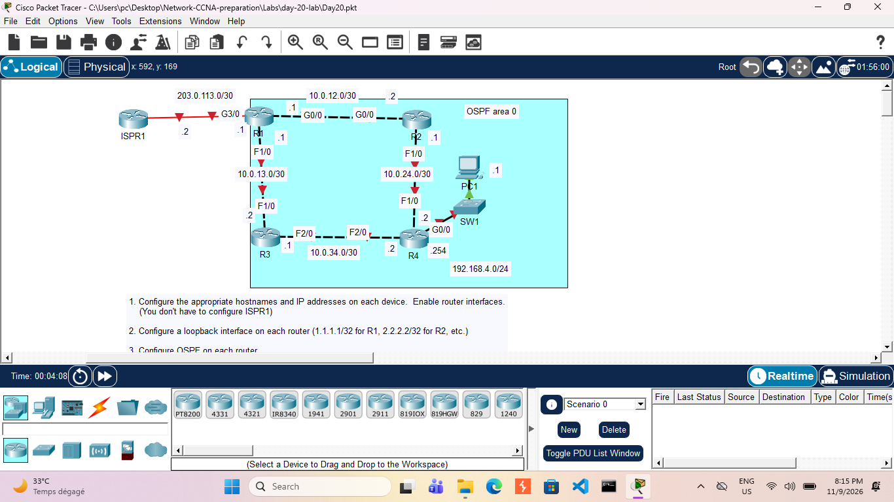

# Day 20: OSPF Single-Area Configuration & Default Route Injection

## Course Reference
This lab is part of **Jeremy's IT Lab** — CCNA 200-301 (Cisco Certified Network Associate) course.

## Objective
Configure basic device settings, loopback interfaces, and OSPF (Single-Area) across a multi-router topology. Additionally, configure R1 as an Autonomous System Boundary Router (ASBR) to inject a default route into the OSPF domain.

## Network Topology

## Devices Used

| Device | Type | IP Address | Role |
|--------|------|------------|------|
| R1 | Router | 203.0.113.1/30, 10.0.12.1/30, 10.0.13.1/30, 1.1.1.1/32 (Lo) | ASBR / Edge Router |
| R2 | Router | 10.0.12.2/30, 10.0.24.2/30, 2.2.2.2/32 (Lo) | Internal OSPF Router |
| R3 | Router | 10.0.13.2/30, 10.0.34.1/30, 3.3.3.3/32 (Lo) | Internal OSPF Router |
| R4 | Router | 10.0.24.1/30, 10.0.34.2/30, 192.168.4.254/24, 4.4.4.4/32 (Lo) | Internal OSPF Router |
| ISPR1 | Router | 203.0.113.2/30 | ISP (Pre-configured) |
| SW1 | Switch | N/A | LAN Switch for PC1 |
| PC1 | Host | 192.168.4.1/24 | End User |

## Configuration Steps

### Task 1 & 2: Basic Configuration and Loopbacks
*(Note: Only key OSPF-related configurations are shown below. IP addresses must be assigned to physical interfaces as per the topology before proceeding).*

**On R1 (Example for Loopback):**

    configure terminal
    interface loopback 0
     ip address 1.1.1.1 255.255.255.255

### Task 3: Configure OSPF (Area 0)
Enable OSPF on all internal interfaces and loopbacks. Make loopbacks and LAN interfaces passive. Do **not** enable OSPF on R1's Internet link (G3/0).

**On R1:**

    configure terminal
    router ospf 1
     network 10.0.12.1 0.0.0.0 area 0
     network 10.0.13.1 0.0.0.0 area 0
     network 1.1.1.1 0.0.0.0 area 0
     passive-interface loopback 0

**On R2:**

    configure terminal
    router ospf 1
     network 10.0.12.2 0.0.0.0 area 0
     network 10.0.24.2 0.0.0.0 area 0
     network 2.2.2.2 0.0.0.0 area 0
     passive-interface loopback 0

**On R3:**

    configure terminal
    router ospf 1
     network 10.0.13.2 0.0.0.0 area 0
     network 10.0.34.1 0.0.0.0 area 0
     network 3.3.3.3 0.0.0.0 area 0
     passive-interface loopback 0

**On R4:**

    configure terminal
    router ospf 1
     network 10.0.24.1 0.0.0.0 area 0
     network 10.0.34.2 0.0.0.0 area 0
     network 192.168.4.254 0.0.0.0 area 0
     network 4.4.4.4 0.0.0.0 area 0
     passive-interface loopback 0
     passive-interface g0/0

### Task 4: Configure R1 as ASBR (Default Route Injection)
R1 needs a default route pointing to the ISP, and then it must be instructed to advertise that route into OSPF.

**On R1:**

    configure terminal
    ! Create a default static route towards the ISP
    ip route 0.0.0.0 0.0.0.0 203.0.113.2

    ! Instruct OSPF to originate and advertise the default route
    router ospf 1
     default-information originate

## Verification

| Test | Command | Expected Result |
|------|---------|-----------------|
| Verify OSPF Neighbors | `show ip ospf neighbor` | All adjacent routers should show a state of `FULL`. |
| Verify Default Route | `show ip route` (on R2, R3, R4) | An `O*E2` route (OSPF External Type 2) for `0.0.0.0/0` is present. |
| Verify Connectivity | `ping 203.0.113.2` (from R4) | Successful ping to the ISP router. |

## What I Learned

- **OSPF Basics:** How to enable OSPF, define networks, and verify neighbor adjacencies.
- **Passive Interfaces:** The importance of using `passive-interface` to prevent OSPF hello packets from being sent on LANs and loopbacks, which saves resources and improves security.
- **ASBR Configuration:** The role of an Autonomous System Boundary Router and how to use `default-information originate` to push a default route to internal OSPF routers.
- **OSPF External Routes:** Understanding the `O*E2` designation in the routing table for routes injected from outside the OSPF domain.

---
