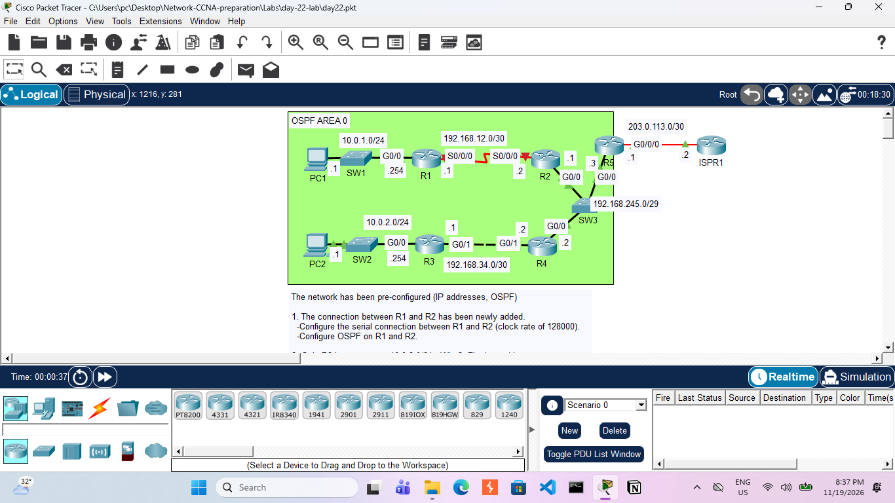

# Day 22: OSPF Troubleshooting & LSA Analysis

## Course Reference
This lab is part of **Jeremy's IT Lab** — CCNA 200-301 (Cisco Certified Network Associate) course.

## Objective
Troubleshoot a pre-configured OSPF network by fixing missing configurations, resolving neighbor adjacency issues (MTU/Mismatch), correcting passive interface configurations, and establishing a default route to the internet. Analyze the Link State Database (LSDB) to identify present LSAs.

## Network Topology

## Devices Used

| Device | Type | IP Address | Role |
|--------|------|------------|------|
| R1 | Router | 10.0.1.254/24, 192.168.12.1/30 | OSPF Internal Router |
| R2 | Router | 192.168.12.2/30, 192.168.245.1/29 | OSPF Internal Router |
| R3 | Router | 10.0.2.254/24, 192.168.34.1/30 | OSPF Internal Router |
| R4 | Router | 192.168.34.2/30, 192.168.245.2/29 | OSPF Internal Router |
| R5 | Router | 192.168.245.3/29, 203.0.113.1/30 | ASBR / Edge Router |
| ISPR1 | Router | 203.0.113.2/30 | ISP (Pre-configured) |
| SW1, SW2, SW3 | Switch | N/A | Access/Distribution Switches |
| PC1 | Host | 10.0.1.1/24 | End User |
| PC2 | Host | 10.0.2.1/24 | End User |

## Configuration Steps

### Task 1: Configure the new Serial connection between R1 & R2
**On R1 (DCE side - Requires clock rate):**

    configure terminal
    interface s0/0/0
     ip address 192.168.12.1 255.255.255.252
     clock rate 128000
     no shutdown
    exit
    router ospf 1
     network 192.168.12.0 0.0.0.3 area 0

**On R2:**

    configure terminal
    interface s0/0/0
     ip address 192.168.12.2 255.255.255.252
     no shutdown
    exit
    router ospf 1
     network 192.168.12.0 0.0.0.3 area 0

### Task 2: Fix R3's routing issue (PC2 cannot reach 10.0.2.0/24)
*Reason: R3's LAN interface (G0/0) is likely configured as passive, or the network statement is missing.*
**On R3:**

    configure terminal
    router ospf 1
     no passive-interface g0/0
     network 10.0.2.0 0.0.0.255 area 0

### Task 3: Fix OSPF adjacency between R2 and R5 (and R4/R5)
*Reason: OSPF Hello packets will not form an adjacency if there is an MTU mismatch. You must ensure the MTU is the same on both sides, or use the `ip ospf mtu-ignore` command if applicable. Also check for area mismatches or missing network statements.*
**On R2 & R5 (Example fix):**

    configure terminal
    interface g0/0
     ip mtu 1500
     ip ospf mtu-ignore
    ! Alternatively, ensure both sides have the same MTU configured.

### Task 4: Fix Internet reachability (PC1/PC2 to 8.8.8.8)
*Reason: R5 acts as the ASBR, but it doesn't have a default route to the ISP, nor is it injecting one into OSPF.*
**On R5:**

    configure terminal
    ip route 0.0.0.0 0.0.0.0 203.0.113.2
    router ospf 1
     default-information originate

## Verification

| Test | Command | Expected Result |
|------|---------|-----------------|
| Verify Neighbors | `show ip ospf neighbor` | R2 and R5 should show `FULL` state. R4 and R5 should show `FULL`. |
| Verify Routing | `show ip route` (on R4) | `O*E2` default route (0.0.0.0/0) is present. |
| End-to-End Ping | `ping 8.8.8.8` (from PC1) | Successful replies (if ISP routing is simulated). |
| LSDB Analysis | `show ip ospf database` | Displays Router LSAs (Type 1) and Network LSAs (Type 2) for the OSPF domain. |

## What I Learned

- **Serial Connections:** Configuring DCE/DTE serial links and the necessity of the `clock rate` command on the DCE side.
- **OSPF Troubleshooting:** Common reasons for adjacency failure, including MTU mismatch, Area ID mismatch, and Hello/Dead timer mismatches.
- **Passive Interfaces:** How an accidentally passive interface can break LAN routing within OSPF.
- **LSA Types:** Understanding Type 1 (Router) and Type 2 (Network) LSAs within a single OSPF area.

---
