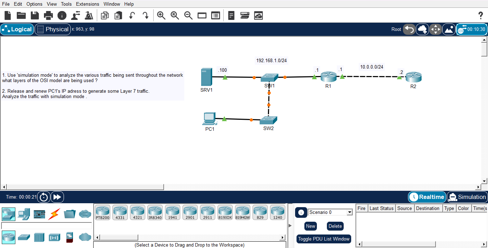

# Day 03: OSI Model - Simulation Mode & Traffic Analysis

##  Course Reference
- **Course**: Jeremy's IT Lab - CCNA 200-301
- **Topic**: OSI Model, Simulation Mode, and Traffic Analysis

##  Objective
Use Packet Tracer's **Simulation Mode** to analyze network traffic and understand which layers of the OSI model are being used during communication.

##  Network Topology

##  Devices Used

| Device | Type | IP Address |
|--------|------|------------|
| **SRV1** | Server | 192.168.1.100/24 |
| **PC1** | PC | DHCP |
| **SW1** | Switch | - |
| **SW2** | Switch | - |
| **R1** | Router | 192.168.1.1/24 (G0/0), 10.0.0.1/24 (G0/1) |
| **R2** | Router | 10.0.0.2/24 |

## Steps

### Part 1: Analyze Traffic with Simulation Mode

1. Switched Packet Tracer to **Simulation Mode**.
2. Generated traffic by pinging from PC1 to SRV1.
3. Observed the traffic flow and identified which OSI layers are involved.
4. Analyzed the packet details at each layer.

### Part 2: Release and Renew PC1's IP Address

1. On PC1, opened the Command Prompt.
2. Ran `ipconfig /release` to release the current IP address.
3. Ran `ipconfig /renew` to request a new IP address from the DHCP server.
4. Observed **Layer 7 (Application Layer)** traffic generated by DHCP.

## 🔍 OSI Model Layers Observed

| Layer | Name | Protocols / Traffic |
|-------|------|---------------------|
| **Layer 7** | Application | DHCP, DNS, HTTP |
| **Layer 6** | Presentation | Data formatting |
| **Layer 5** | Session | Session management |
| **Layer 4** | Transport | TCP, UDP |
| **Layer 3** | Network | IP, ICMP, ARP |
| **Layer 2** | Data Link | Ethernet, MAC addresses |
| **Layer 1** | Physical | Cables, signals |

## 📊 Traffic Analysis

### Ping from PC1 to SRV1

| Step | Protocol | Layer | Description |
|------|----------|-------|-------------|
| 1 | ARP | Layer 2 | PC1 asks for SRV1's MAC address |
| 2 | ICMP | Layer 3 | Echo Request sent to SRV1 |
| 3 | ICMP | Layer 3 | Echo Reply received from SRV1 |

### DHCP Process (Layer 7)

| Step | Message | Description |
|------|---------|-------------|
| 1 | **DHCP Discover** | PC1 broadcasts to find a DHCP server |
| 2 | **DHCP Offer** | Server offers an IP address |
| 3 | **DHCP Request** | PC1 requests the offered IP |
| 4 | **DHCP ACK** | Server confirms the IP assignment |

##  What I Learned

1. **Simulation Mode**:
   - Allows step-by-step analysis of network traffic.
   - Shows how packets travel through the network.
   - Helps understand the OSI model in practice.

2. **OSI Model Layers**:
   - Each layer has a specific role in communication.
   - Traffic passes through all layers before being sent.
   - Understanding layers helps in troubleshooting.

3. **DHCP Process**:
   - Uses **Layer 7 (Application)** and **Layer 4 (Transport)**.
   - 4-step process: Discover → Offer → Request → ACK.

4. **ARP Protocol**:
   - Used to find MAC addresses (Layer 2).
   - Essential for communication within a LAN.

---