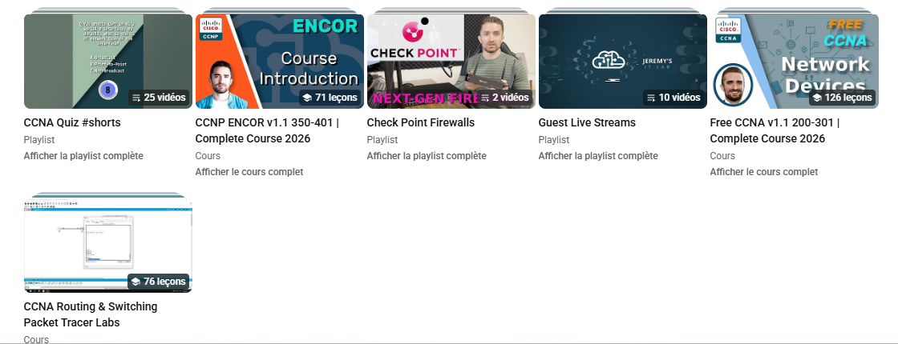
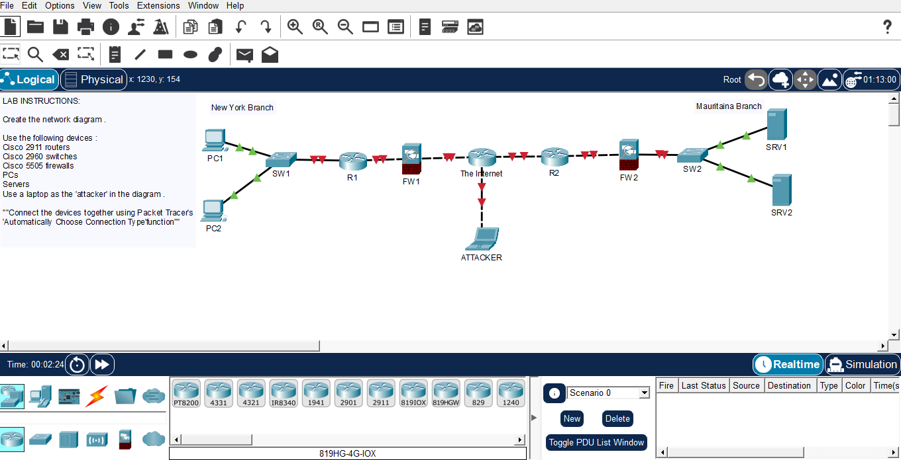

# My CCNA Journey: From Zero to Network Engineer

# The story 

Welcome to my CCNA journey!

Every expert was once a beginner. This repositery is not a collection of labs; it's the story of my transformation.

I strart my cybersecurity journey a year ago, exploring many areas: penetration testing, web security, and network defence.

I built home labs, solved Portswigger challenges....

But I realized something: **without a solid foundation in networking, everything else would be built on sand.**

So I decided to go back to the roots. 
I'm following **Jermy's IT Lab** course, one of the best CCNA courses on Youtube, and documenting every single lab here.


## Preview

### The course



### The Lab




## Challenge

- **Course**: Jeremy's IT Lab (CCNA 200-301)
- **Goal**: Complete all labs and document them here
- **Frequency**: One lab per day
- **Total Labs**: [Depends on the course]

## Progress Tracker

| 01 | Packet Tracer Introdiction | Basic Connectivity |

| 02 | Connection Devices | Interface Configuration |

| 03 | OSI Model | IP Addressing |

| 04 | Devices security | Encryption... |

| 05 | Life of Packet | Simulation mode... |
.......

*(Updated daily as I progress through the course)*

## What I Will Learn

By the end of this journey, I will master:

- **Network Fundamentals**: OSI Model, TCP/IP, Cabling...
- **IP Addessing & Subneting**: IPv4, IPv6, VLSM
- **Switching**: VLANs, Trunkimg, STP, EtherChannel
- **Routing**: Static, OSPF, DNS, NTP, Syslog
- **Network Services**: ACLs, NAT, SSH, Port security

---

## Repository Structure

```
Network-CCNA-preparation/
│
├── README.md
├── youtube-screenshot.png
├── lab-screenshot.png
│
└── Labs/
    │
    ├── day-1-lab/
    │   ├── README.md
    │   ├── lab.pkt
    │   └── lab-screenshot.png
    │
    ├── day-2-lab/
    │   ├── README.md
    │   ├── lab.pkt
    │   └── lab-screenshot.png
    │
    ├── day-3-lab/
    │   └── ...
    │
    └── ...
```

## Connect with me

-**LinkedIn**:[www.linkedin.com/in/hamdinou-el-keihel-b7955b3b0]

-**Email**: hamdinouyhy@gmail.com

-**Github**:[https://github.com/hamdinouyhy]

## Support
If you find this repository helpful, please give it a star!

----